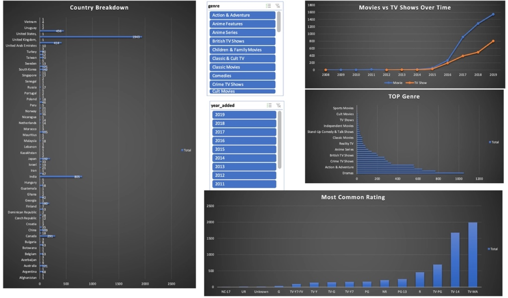

# Netflix Content Analysis (Excel)

Interactive Excel dashboard analyzing ~6,000 Netflix movies and TV shows — what gets added, where it comes from, and how the catalog skews by genre and rating.

## Dataset
Netflix catalog data (~6,000 titles) with metadata on type, title, director, cast, country, release year, rating, duration, genre, and date added.

## What I Built

**1. Normalized data model.** Split the raw flat file into linked tables keyed by `show_id`, so multi-value fields don't repeat:
- `netflix_titles` — one row per title (6,221 titles)
- `netflix_titles_directors` — 4,850 director credits
- `netflix_titles_countries` — 7,179 country credits
- `netflix_titles_cast` — 44,310 cast credits
- `netflix_titles_category` — 13,670 genre tags
- `Master_view` — 6,037 titles joined back together for analysis

**2. Data cleaning.** Parsed the raw duration field into `duration_minutes`, `duration_seasons`, and a cleaned duration column; extracted `year_added` from the full date added.

**3. Pivot analysis** (`PIVOT` sheet):
- Movies vs TV shows by year added
- Ratings distribution
- Genre counts
- Country counts

**4. Interactive dashboard** (`DASHBOARD` sheet): charts for movies vs TV shows over time, top genres, most common ratings, and country breakdown — filterable with `year_added` and `genre` slicers.

## Key Findings
- **Dramas** is the #1 genre (1,049 titles), followed by Comedies (771) and Documentaries (642)
- **TV-MA** is the most common rating (1,990 titles), then TV-14 (1,674)
- The **United States** dominates the catalog (1,943 titles), then the UK (414) and India (800+)
- Catalog growth explodes after 2015 — 2019 alone added 1,546 movies and 803 TV shows
- Movies consistently outnumber TV shows, and the gap widens every year

## Tools Used
- **Microsoft Excel** — pivot tables, slicers, charts, data cleaning and modeling

## Files
- `netflix_content_analysis.xlsx` — the full workbook (data tables, master view, pivots, dashboard)
- `images/dashboard.jpg` — dashboard screenshot
